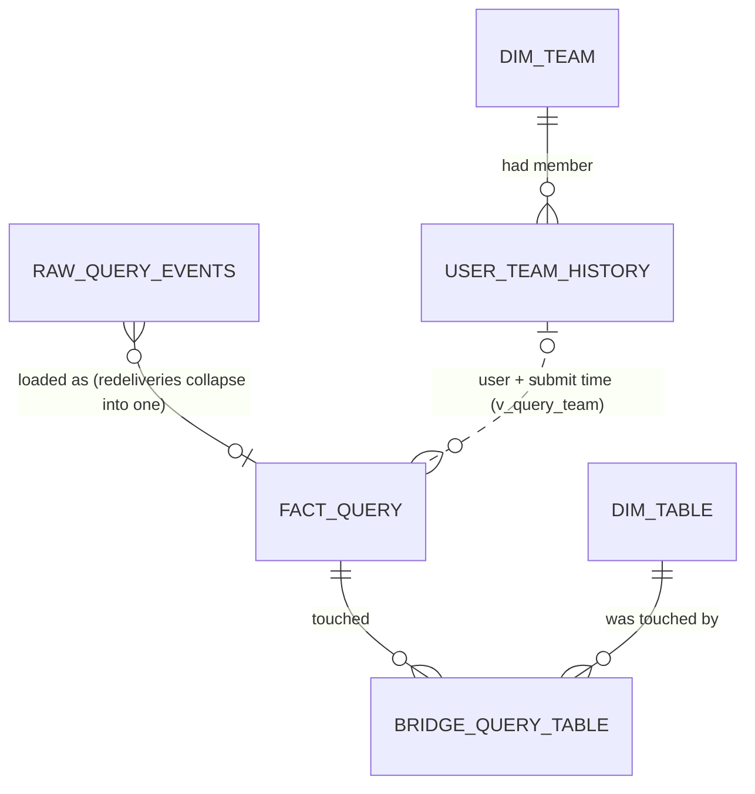

# Meta DWH: usage statistics for Trino tables

This repository has a data model for a small Meta DWH and the SQL that fills it from raw Trino query
events. It answers two questions for any period: how many distinct users queried a table, and how many
resources a team used. Every query is kept, so the same questions can also be asked per day to see how
usage changes over time.

The input is Trino's query-completed event (`QueryCompletedEvent`). For each query it names the user, the
tables the query read and wrote, and the resources it used.

## Run it

Docker is the only requirement. From the repository root:

```
docker compose run --rm runner
```

The command starts Trino 484 with an Iceberg catalog and builds everything from scratch: it deletes what
an earlier run left (raw events included), creates the tables, loads three sample batches of events,
answers the example questions and runs the tests. The answers are compared with 31 values written down in
advance (`fixtures/expected/`). Exit code 0 means everything matched. On my Mac it takes about seven minutes,
mostly tests.

A saved macOS run (Apple silicon) is in [`docs/run-output.txt`](docs/run-output.txt). I also ran an earlier
version on a Windows laptop with an AMD processor: all 204 tests passed in about 17 minutes, with the same
sample answers. Nothing was run against AWS.

There are two groups of tests:

- `tests/` checks the rules described in this README, on the sample data and on real captured events.
- `tests/adversarial/` computes both answers again from the raw event files in plain Python, without SQL.
  It also loads the batches in another order, loads them more than once, sends conflicting versions of a
  query, and stops a load halfway.

## Where to find what the task asks for

| The task asks for | Where |
|---|---|
| Proposed tables, their granularity and relationships | [Data model](#data-model), `sql/ddl/02_model.sql` |
| SQL and/or Python code to create and populate the tables | `sql/ddl/`, `sql/load/`, `sql/views/`; a small runner in `pipeline/` |
| Example queries answering the two questions | [The example questions](#the-example-questions), `sql/queries/` |
| Design choices, resource metrics, how data is updated | [What the numbers mean](#what-the-numbers-mean), [Resource metrics](#resource-metrics), [How the data is updated](#how-the-data-is-updated) |
| Assumptions: users to teams, queries over several sources | [What the numbers mean](#what-the-numbers-mean), [Assumptions and limits](#assumptions-and-limits) |
| Additional metadata, its structure and use | `dim_team`, `user_team_history` in [Data model](#data-model) |
| Historical perspective on how usage changes | [History](#history), `sql/queries/trend_*.sql` |

## Data model



| Table | One row is | Key | What it holds |
|---|---|---|---|
| `raw.query_events` | one delivered event message | `delivery_id` | The event JSON as it arrived, plus delivery columns. This table is my assumption about the input. |
| `fact_query` | one completed query | `cluster_id, query_id` | User, times, state and all query-level measures. These measures are stored only here. |
| `bridge_query_table` | one table touched by one query, per access type | query key + `catalog, schema, table` + `access_type` | Which tables a query read or wrote, and the bytes and rows it read from each. No CPU or memory. |
| `dim_table` | one table | `cluster_id, catalog, schema, table` | Tables seen in at least one query, with the first and last day they were seen. |
| `dim_team` | one team | `team_id` | Additional metadata. Includes the reserved team `UNASSIGNED`. |
| `user_team_history` | one membership interval of one user | `user_name, valid_from` | Additional metadata: who was in which team, and when. |
| `v_query_team` (view) | one completed query | same as `fact_query` | `fact_query` plus the team the query belongs to. |
| `etl_batch` | one delivery batch | `batch_id` | Load log: status and counters. |

The two questions need different grains. CPU and memory are measured per query, so they are stored once
per query in `fact_query`. Which tables a query used is a many-to-many relationship, so it goes into a
bridge table. The bridge holds only what Trino measures per table: bytes and rows read. The team query
does not use the bridge, so a query that read several tables is counted once.

**Additional metadata.** Trino events do not say which team a query belongs to. `groups` is a list (one
user can be in several groups), `resourceGroupId` is about scheduling, and `clientTags` and `source` are
free text set by the client. So the team mapping comes from outside, in practice from an export of the org
directory, as `user_team_history(user_name, team_id, valid_from, valid_to)`.
`sql/load/01_check_reference.sql` runs six checks on the team data: on a new version before it replaces
the old one, and again before every load. The main one is that the intervals of one user never overlap, so
a query gets at most one team. A rejected version leaves the old one in place. An accepted one replaces
each table in one commit (`sql/load/02_replace_reference.sql`), so a reader never sees half of it.

Every table and column has a comment in the catalog. Table comments give the grain and the key, and the
comments on the main measures say whether they can be summed. The demo reads the table comments back from
the catalog and prints them.

`fact_query` is partitioned by day of `end_time` and the bridge by query date, so Trino can skip
partitions outside the period of a query.

## The example questions

Sample data: 14 queries by 6 users in 3 batches, with two redeliveries and two events that arrive days
late, one of them in the period (`fixtures/events/`). Period: `[2026-11-01, 2026-11-05)` UTC. The
queries in `sql/queries/` take parameters; here they are shown with the sample values filled in.

### How many distinct users queried `lake.sales.orders`?

```sql
SELECT count(DISTINCT f.user_name) AS distinct_users
FROM fact_query AS f
JOIN bridge_query_table AS b
    ON b.cluster_id = f.cluster_id AND b.query_id = f.query_id
WHERE b.cluster_id = 'demo'
  AND b.catalog_name = 'lake' AND b.schema_name = 'sales' AND b.table_name = 'orders'
  AND b.access_type = 'READ'
  AND b.query_date BETWEEN DATE '2026-11-01' AND DATE '2026-11-05'  -- reads only these days' bridge partitions
  AND f.query_state = 'FINISHED'
  AND f.end_time >= TIMESTAMP '2026-11-01 00:00:00 UTC'
  AND f.end_time <  TIMESTAMP '2026-11-05 00:00:00 UTC';
```

Answer: **4**.

Per day the counts are 1, 3, 2 and 1. Their sum, 7, is not the answer: distinct counts cannot be added up
over days, so the query counts over the whole period at once.

### How many resources did team `analytics` use?

```sql
SELECT count(*)                         AS query_count,
       count_if(query_state = 'FAILED') AS failed_query_count,
       sum(cpu_time_seconds)            AS cpu_seconds,
       sum(physical_input_bytes)        AS physical_input_bytes,
       count_if(physical_input_bytes IS NULL) AS queries_without_input_bytes,
       max(peak_user_memory_bytes)      AS max_query_peak_memory_bytes
FROM v_query_team
WHERE team_id = 'analytics'
  AND end_time >= TIMESTAMP '2026-11-01 00:00:00 UTC'
  AND end_time <  TIMESTAMP '2026-11-05 00:00:00 UTC';
```

| query_count | failed_query_count | cpu_seconds | physical_input_bytes | queries_without_input_bytes | max_query_peak_memory_bytes |
|---|---|---|---|---|---|
| 9 | 1 | 42.5 | 4100 | 0 | 1000 |

Two of these queries read two tables each and are still counted once, because this query does not use the
bridge. The three teams together (`analytics` 42.5, `platform` 28, `UNASSIGNED` 5) give 75.5 CPU seconds,
the total of all 12 queries that ended in the period.

### A third one: how much data was read from each table?

`sql/queries/q3_table_read_volume.sql`, same period, all completed queries:

| table | queries | physical_input_bytes | physical_input_rows | queries_without_input_bytes |
|---|---|---|---|---|
| `lake.sales.orders` | 8 | 3500 | 35 | 0 |
| `lake.sales.customers` | 4 | 2450 | 24 | 0 |
| `lake.sales.daily_revenue` | 1 | 1000 | 10 | 0 |
| `pg.sales.orders` | 1 | 450 | 4 | 0 |

Trino reports these numbers per scan, so a self-join counts both scans. The four tables add up to 7400
bytes, the same total the queries report themselves. That was also true for every captured real event, but
Trino does not promise it.

## History

Nothing is overwritten. Every completed query is kept with its submit and end time, so usage can be looked
at for any period. Two periods are compared by running the same query for each, for example this week and
last week. The trend queries (`sql/queries/trend_*.sql`) return the first two answers per day. A day
without matching queries has no row. On the sample:

| day (UTC) | distinct users of `lake.sales.orders` | CPU seconds of `analytics` |
|---|---|---|
| 2026-11-01 | 1 | 17.0 |
| 2026-11-02 | 3 | 10.0 |
| 2026-11-03 | 2 | 5.0 |
| 2026-11-04 | 1 | 10.5 |

Two things can still change a past number: an event that arrives late, and a corrected team mapping (the
team is looked up when the data is read).

## What the numbers mean

| Term | Meaning | Reason |
|---|---|---|
| "Queried table X" | A `FINISHED` query with X among its inputs (`ioMetadata.inputs`). | A failed query may have read part of the table or nothing at all (a typo, a missing permission). Without the state filter the query counts attempts instead. |
| Reads through a view | Counted for the table under the view. | Trino reports the base table as the input. Nothing is parsed from the SQL text. |
| Writes | A separate access type, `WRITE`. A query that only writes a table did not query it. | Who writes a table and who reads it are different questions. |
| Read and written by one query | The table gets both `READ` and `WRITE`, so a job that `MERGE`s into a table counts as one of its readers. In the sample the ETL account is the only reader of `daily_revenue`. | Trino reports `MERGE` and `INSERT INTO t SELECT ... FROM t` this way. Filter on `fact_query.query_type` to leave such jobs out. |
| Several tables or sources in one query | One bridge row per table. Catalogs are kept apart. | The same table name in another catalog is a different table. |
| User | `context.user`, service accounts included. | With impersonation, `principal` would merge all users of a BI tool into one. |
| Period | `[from, to)` by the query's **end** time, UTC. | The event exists only after the query ends. A late event still lands in the day the query ended. |
| Team of a query | The user's team at the query's **submit** time, or `UNASSIGNED` if there is none. | The team that started the work pays for it, and no usage is lost. |
| Resources of a team | All its completed queries, **including failed ones and ones that read no table**. A team with no queries in the period gets 0 queries and `NULL` sums. | The cluster spent the resources either way. |

### Resource metrics

CPU seconds (`statistics.cpuTime`) is the main metric, and physical input bytes shows how much data was
read. Both can be added up, and both are summed once per query. Bytes and rows read are also kept per
table.

Peak memory cannot be added up: the events do not say whether the peaks of different queries happened at
the same time. It is reported only as a maximum, the largest peak that one of the team's queries
reported.

There is no CPU per table. Trino measures CPU per query, and splitting it across tables would be a guess
shown next to measured numbers.

## How the data is updated

Data is loaded in closed delivery batches. `Warehouse.load_pending()` in `pipeline/warehouse.py` loads
every batch that is not loaded yet, in the order the batches were received. A scheduler would call it; the
demo calls it for the sample batches. Batches are picked from the delivery log, not by query time, so an
event that arrives days late is still loaded, into the day it belongs to.

Each pending batch goes through these steps (`sql/load/`): validate the events, turn them into typed rows,
check for conflicts, `MERGE` into `fact_query`, `MERGE` into `bridge_query_table`, `MERGE` into
`dim_table`, check that the batch is complete and the model invariants hold, and mark the batch
`SUCCEEDED`.

- **Only the reading layer knows the JSON shape of an event.** Trino does not guarantee that shape between
  versions. The raw JSON is stored as it arrived. A batch with a missing or wrongly typed field, a value
  that cannot be right (such as a negative CPU time, a query state other than `FINISHED` or `FAILED`, or a
  time without a time zone) or an event from an unchecked Trino version is rejected as a whole, and the
  bad message is named. No event is dropped silently.
- **Loading a batch again changes nothing.** Each step only adds what is missing.
- **Order does not matter.** The same batches in any order give the same rows, except for the audit
  columns (which batch loaded a query) and the counters in the load log.
- **A crash is fixed by the next run.** The steps are separate Iceberg commits, not one transaction. A
  batch counts as loaded only after the last step; otherwise it is loaded again from the start. Someone
  reading in the middle of a load can see a partly loaded batch, and `etl_batch` shows which one.
- **A redelivered event is ignored, a conflicting one stops the batch.** A hash over everything the model
  takes from an event tells the two cases apart. Two different versions of one completed query mean that
  collection is broken, and keeping the latest one would hide that.
- **A rejected batch blocks the load** until someone fixes it. A run stops at the first batch that fails,
  so the rejected batch is tried again on every run and no batch received after it is loaded. Loading
  past it would hide the problem.
- **Only one load can run at a time.** The staging tables are shared, so the scheduler must not start a
  second load, or an update of the team data, while one is running.
- **History is recalculated** with `docker compose run --rm runner python -m pipeline rebuild`, which
  rebuilds the derived tables from the raw events. Team attribution needs no rebuild: it is a view over
  the membership history, so a corrected mapping applies right away.

The tests for loading again, loading in another order, a crash and a rebuild compare the whole content
of `fact_query`, `bridge_query_table` and `dim_table`, apart from the audit columns. That only one load
runs at a time is not tested; the scheduler has to make sure of it. An optional measure missing from an
event stays `NULL`, never 0 (CPU time is required). For input bytes and rows, the queries also report how
many queries did not have the value.

## Assumptions and limits

- **Input.** I assume one append-only Iceberg table with the raw event JSON and a batch id set by the
  collector. The collector has to close a batch: all of its events are in the table before a load can see
  it. The load cannot tell a finished batch from one that is still being written, and an event added to a
  batch after it was loaded is never loaded. The demo's `ingest` writes a large batch in several
  `INSERT`s, so it must not run during a load. If the events are split over several tables, the steps
  that read the raw table change (finding pending batches and reading events), but the model does not.
  Without a batch id, an Iceberg snapshot range can be used as the unit of loading.
- **Event shape.** The fields come from Trino's
  [event listener SPI](https://trino.io/docs/current/develop/event-listener.html). The reading layer was
  written against real events captured from Trino 484's HTTP event listener (`fixtures/captured/`), not
  against JetBrains' cluster. Other listeners may wrap the events differently.
- **Storage.** Table data is on the local file system of the Trino container, not S3. Moving to S3 means
  replacing the storage lines and the warehouse location in `trino/catalog/iceberg.properties`. The JDBC
  catalog there stands in for Glue or a metastore. The SQL and the Iceberg tables are real.
- **Completeness.** The model is correct for the events it received. An event that was never delivered
  cannot be recovered here.
- **Team history comes from outside.** Directory exports usually have only the current state, so daily
  snapshots have to be turned into intervals. A corrected mapping also changes past numbers, since the
  team is looked up on read. To reproduce an old report exactly, the mapping itself would need versions.
- **Table identity is the reported name.** A renamed table is a new table, Iceberg metadata tables such as
  `orders$snapshots` count as separate tables, and the same table reached from two clusters or catalogs
  counts twice.
- **One team per user at a time.** The team data checks reject a user who is in two teams at once.
- **Precision.** Trino sends nanoseconds and Iceberg stores microseconds. Timestamps are cut to
  microseconds, never rounded, so a query cannot move across a period boundary, as long as the boundary
  itself is a whole microsecond (a day, in practice).

Not included: daily summary tables (a table × user × day table would keep distinct counts exact), "tables
nobody queries" (this needs the list of all tables in the catalog as more metadata), and scheduling.
